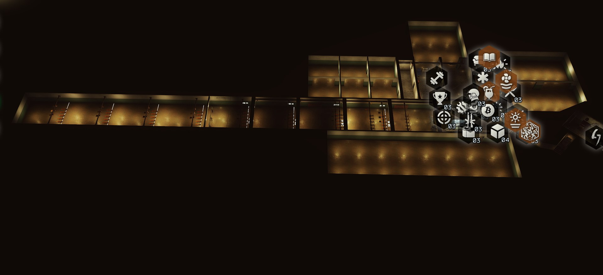

# Changelog

## 1.3.0

Needs SPT 4.1.x (made on 4.1.6). Install over 1.2.0; your rooms and the places you moved areas to carry over. Nothing changed on the server.

### Added

- **Your rooms and layout in Tushonka: Hideout Under Siege.** The siege loads the hideout as a raid map, and now it has your built rooms (doorways cut, doors in, lamps lit) and your areas where you moved them. In co-op everyone gets the host's.
- **For modders:** `HideoutExtensionsApi.RaidCopySnapshot()` and `BuildRaidCopy(snapshot)` put a player's rooms and layout into any raid that loads the hideout's scene, and `AddRaidRoom(spotJson)` adds a room of your own to that copy. See "The hideout as a raid map" in the README.
- **Openings** (a room reached from another) can be a bare doorway with no door (`"open": true`) and any size (`width`, `height`).

### Fixed

- **Right-clicking in an area's panel picked up the area behind it to move.** Right-click examines a requirement's item, and an area icon underneath the panel was picked up at the same time. Only an icon that's on top is picked up now.
- A room's old walls and doors are gone the moment it's rebuilt, not at the end of the frame: anything checking the room straight after a doorway was added (as the siege does when it walks the floor) found the old wall still across it.

## 1.2.0

Needs SPT 4.1.x (made on 4.1.6). Install over 1.1.0 and restart the SPT server; your rooms and the places you moved areas to carry over. Works alongside Fika 2.4 (the hideout is your own; nothing about it is shared in co-op).

### Added

- **Five new parts of the hideout to build**, each on its own:
  - **Annex far room**: the annex's fourth room, through a door in the north room's back wall.
  - **East hall** (12.5 x 12.5 m): knocks out the east walls of the gym and the mannequin room, leaving two wide openings.
  - **South wing** (18 x 16 m): a door in the long room's end wall, between the air filter and the heating.
  - **West hall** (10.5 x 37 m): a door beside the stash where the tall safe stood; one long room behind the main hall and down the side of the range.
  - **Range extension** (9 x 40 m): breaks out the range's end wall and carries the range on to about 89 m, with distance marks every 10 m and a row of poppers and paper targets at each. It's there from the start: nothing to build.
- **TARGET DISTANCE sign** on the range's firing line: look at it and pick a distance from your interact prompt; only that row stands. Targets take bullet holes, drop when hit and come back up after a few seconds.
- **Zoom out further on the overview.** Once the game's own zoom is all the way out, scrolling out backs the camera away (up to 80 m by default, setting *Overview camera > Extra zoom out (m)*), so the whole hideout fits on screen. The fog thins to match, and goes back when you zoom in.
- **Rooms are lit evenly**: lamps in rows across the whole room (and in front of each target row on the range), following the hideout's light switch.
- **The rooms' walls stop bullets.**
- For modders, new spot fields: `built` (a room that's there from the start), `links`, `props` (copies of the hideout's things, live targets too), door `width`, `height` and `open`. See *For modders* in the README.

### Also out now

- **Hideout Interiors**, a separate mod for moving the hideout's single things (a box, a shelf, a lamp), giving them to other areas, hiding them and decorating with copies. It works with or without Hideout Extensions; things you give to an area move with it when you move the area here.

### Changed

- **Shorter builds:** the annex corridor 1 h, south room 45 min, north room 1 h (they were 4, 3 and 5 hours); the new rooms 1 to 2.5 h.

### Fixed

- **A moved area stays under the mouse.** Picked up from its icon, an area could sit far from the cursor when the game draws the 3D view at a lower resolution than the window.
- **Room icons on the overview** sit where they belong at any render scale.
- **Doors through the hideout's walls stay open after a restart.** The game puts its customized walls in after the rooms are laid out, so a doorway could stand solid until something was built; it's cut again when the walls change.
- **The west hall's door opens from any angle.** The stash's OPEN STASH prompt zone stood over it; areas' prompt zones are now cut round every door.
- **Less freezing while rooms are built.** Starting or finishing a build rebuilt every room's walls and lamps and the rooms' navmesh in one go; now only the rooms whose doorways changed are rebuilt, and the navmesh is built in the background and only when the rooms change.
- **No small hitch every couple of seconds** from checking the hideout's walls and customization: it's checked when the game actually changes them.
- The overview's camera reaches the far rooms, and the areas they open off stay drawn from inside them.

## 1.1.0

Needs SPT 4.1.x. Install over 1.0.0; your rooms and the places you moved areas to carry over.

### Fixed

- **Stutter every 2 seconds in the menus** (stash, traders and the rest), reported with 1.0.0. The hideout stays loaded behind the menus, and two jobs kept searching it:
  - The lamps hung where a moved area used to stand: the check for whether every moved area had its lamps never came out as done, and it searched the whole hideout scene again every 2 seconds while some areas weren't set up (as they aren't in the menus). It now looks the areas up once a visit, stops once every moved area is lit, and otherwise checks less and less often.
  - Setting up the rooms: the search through the hideout for what rooms are made of now happens once per hideout. If something else removes the rooms while the hideout is still loaded, they're set up again when you next open the hideout instead of every 2 seconds (the log says so once), and a setup that keeps failing is tried less and less often.

If you still see a regular stutter in the menus with 1.1.0, please report it with your `BepInEx/LogOutput.log`.

## 1.0.0

First release.
