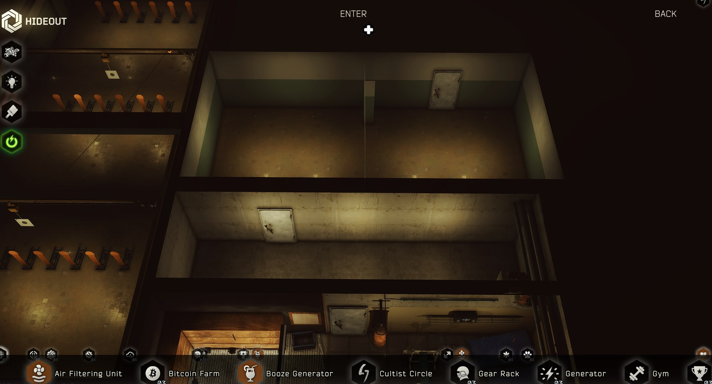
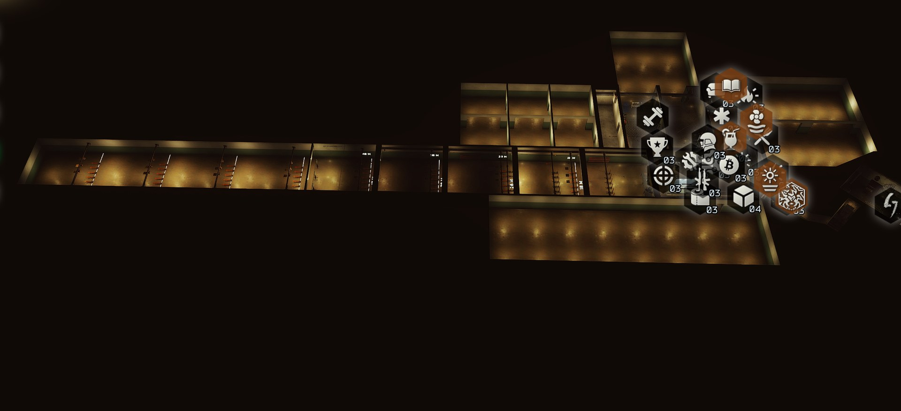
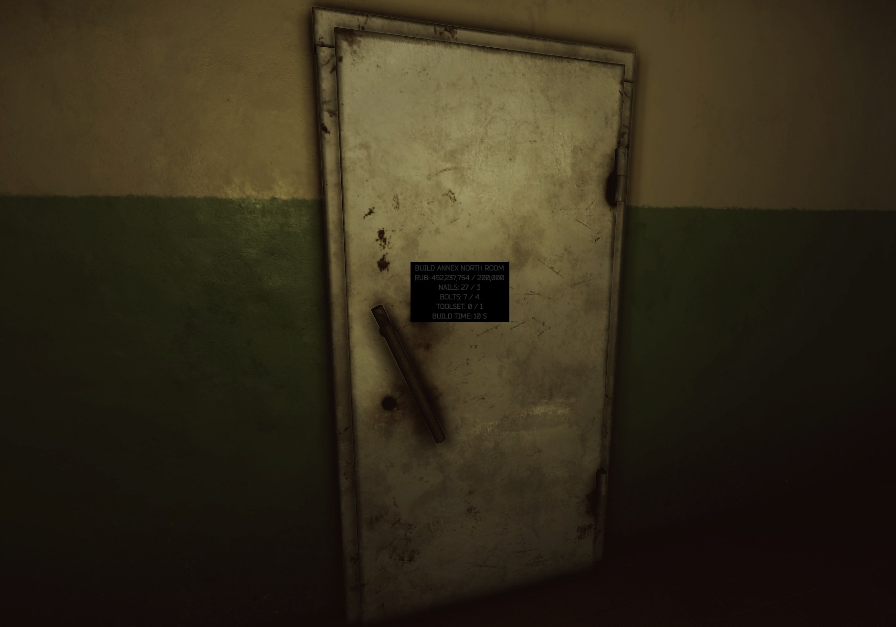
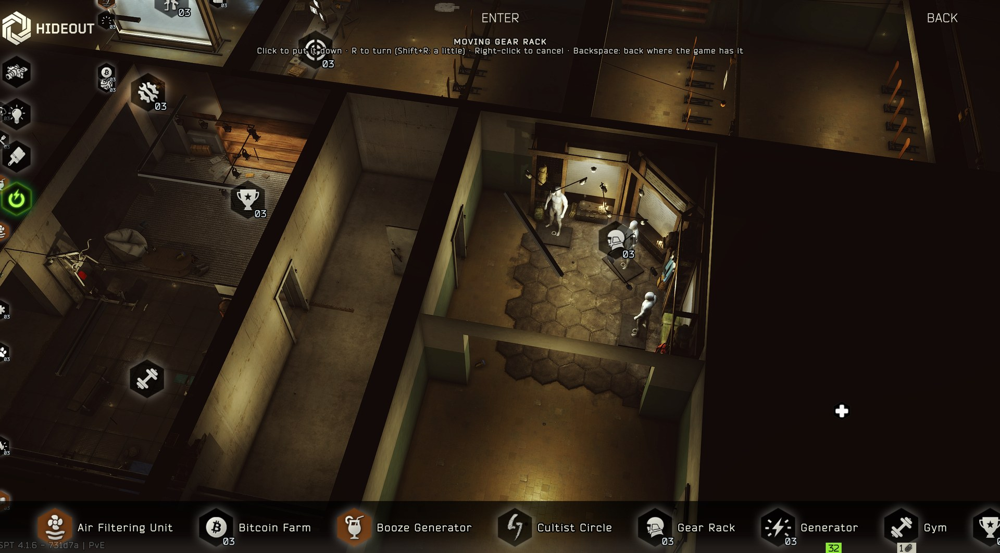
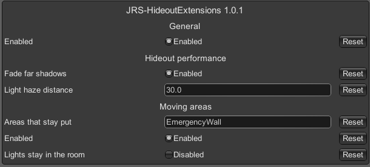

# Hideout Extensions

By JRS.

Hideout Extensions lets you build new rooms onto your hideout, move the hideout's areas wherever you like, and makes the hideout run a bit lighter. Other mods can use it too: they can add their own rooms, furnish the rooms, and let players move their own things around the hideout.





## Contents

- [Installing](#installing)
- [Building rooms: the annex](#building-rooms-the-annex)
- [Moving the hideout's areas](#moving-the-hideouts-areas)
- [Hideout performance](#hideout-performance)
- [Settings](#settings)
- [Uninstalling](#uninstalling)
- [Bugs and feedback](#bugs-and-feedback)
- [For modders](#for-modders)
- [How it works](#how-it-works)
- [Limits](#limits)

## Installing

Needs **SPT 4.1.x**. No other mods are needed.

1. Close the SPT server and the game.
2. Extract the zip into your SPT folder (the one with `BepInEx` and `SPT_Runtime` in it), and merge the folders if asked.
3. Start SPT as usual.

The mod comes in two parts, and you need both:

| Folder | What it does |
| --- | --- |
| `BepInEx/plugins/HideoutExtensions` | The client part: the rooms, doors, prompts and overview icons, and moving areas. |
| `SPT_Runtime/user/mods/HideoutExtensions.Server` | The server part: the list of rooms, what they cost, and taking the materials when you build. |

## Building rooms: the annex

The mod comes with **the annex**: four rooms behind the gym that you build one after another. To start, the emergency wall must be at level 6.

```
              north ↑
   ┌──────────────────────────────┐
   │ 3. north room ┊              │
   ├────────────────────[door]────┤
   │ 2. south room ┊              │
   └────[door]────────────────────┘
   ┌───── 1. annex corridor ──────┐
   └───────────[door]─────────────┘
            gym's back wall           ┊ = pillar wall
```

1. **The annex corridor.** There's already a sealed concrete corridor behind the gym's back wall in the game's model. Building it puts a door in the gym's back wall, between the Place of Fame shelf and the gym gear, and lights the corridor. It also moves the punching bag half a metre to the right and removes the blue mat under it, so they're out of the door's way.
2. **The south room.** Through a door in the corridor's back wall.
3. **The north room.** Through a door in the south room's back wall.
4. **The far room.** Through a door in the north room's back wall.

### Beyond the annex

Four more parts of the hideout are built the same way, each on its own:

| Room | Where you get in | Needs | Cost | Build time |
| --- | --- | --- | --- | --- |
| East hall (12.5 x 12.5 m) | Knocks out the east walls of the gym and the mannequin room, leaving two wide openings. A locker, a poster and the rubble along those walls go | Emergency wall level 6 | 250,000 roubles, 4 packs of nails, 5 bolts, 1 toolset | 1.5 h |
| South wing (18 x 16 m) | A door in the long room's end wall, between the air filter and the heating. The barrels on the pallet in front of it go | Emergency wall level 6 | 400,000 roubles, 5 packs of nails, 6 bolts, 1 electric drill, 1 toolset | 2 h |
| West hall (10.5 x 37 m) | A door in the main hall's wall beside the stash, where the tall safe stood (the safe goes). One long room behind the main hall and down the side of the range | Emergency wall level 6 | 600,000 roubles, 8 packs of nails, 9 bolts, 1 electric drill, 1 toolset, 1 pack of screws | 2.5 h |
| Range extension (9 x 40 m) | Breaks out the range's end wall, leaving a wide opening | None: it's there from the start | Free | No build |

The range extension takes the range from about 49 m to about 89 m, with a line and white distance marks every 10 m, and at each mark a row of six poppers and three white paper targets.

**Picking a distance.** Walk up to the **TARGET DISTANCE** sign on the firing-line bench and look at it. Your interact prompt lists every distance, **All targets** and **Range's own targets**. Pick a distance and only that row stands, with everything else on the range down, the game's own targets too. The sign shows what's picked. Targets take bullet holes, drop when hit and come back up after a few seconds.

The new targets aren't part of the range's training or scores, and the paper targets don't run along their rails: the game's own controls still work only its own targets.

### How to build a room

There are two ways:

- **In first person:** walk up to the closed door where the room will go and look at it. The prompt shows what the room costs, how much of each item you have, and the build time. Choose **Build** to start.
- **On the overview:** a plus icon sits over every room you can build next. Click it to open a panel with the same information and a **Build** button.

If a room is locked, the prompt and the panel say why (for example, the room before it isn't built yet). The materials come from your stash, counted the same way the hideout's own upgrade screens count them. While a room is being built, its overview icon counts down the time left. When it's done, the door works and the room appears straight away, even if you're in the hideout at the time.



### What you get

- **Real doors.** Every doorway gets a copy of the emergency wall's metal door with the game's own door script. You open, close and breach it like any hideout door, with the same prompt, hand animations and sounds. A door stays as you left it until you leave the hideout.
- **Lights that follow the light switch.** Each room has ceiling lamps copied from the hideout's own, and they follow the light switch on the overview like the areas' lamps do: fluorescent tubes, bulbs, Christmas and Halloween lights, or off.
- **Your hideout's look.** The south and north rooms use the main hall's walls, floor and ceiling, and change with them when you change the hideout's customisation. The corridor stays bare concrete.
- **A proper room shape.** The south and north rooms are about 12.8 x 6.3 m and 3.1 m high, each split into two bays by a pillar wall like the one in the room behind the emergency wall.
- **Shown on the overview.** A built room shows from above like the hideout's own rooms, so you can see the annex fill in room by room.

Everything is built from the hideout's own models and materials each time you visit. Nothing is shipped with the mod or extracted from the game.

## Moving the hideout's areas



On the overview, **right-click an area's icon** to pick the whole area up. It follows your mouse across the floor, with everything that belongs to it: its furniture, its lights, its click zone, its icon, and the camera view you get when you open it.

| Key | What it does |
| --- | --- |
| **R** | Turn it a quarter |
| **Shift+R** | Turn it 15° |
| **Left-click** | Put it down |
| **Right-click** | Cancel, and put it back where it was |
| **Backspace** | Send it back to where the game has it |

Where you put each area is saved per profile and set again every visit. The file is `BepInEx/config/jrs.hideoutextensions.layout.<profile id>.json`; delete it to put every area back.

Good to know:

- **Lights move with the area**, because most of an area's lights are its own (spotlights aimed at its displays, candles on its shelves, bulbs on its cables). The spot the area leaves gets plain ceiling lamps so it isn't dark, and they go again when you put the area back. Turn on `Lights stay in the room` if you'd rather leave the lights where they were.
- **The walls don't move.** Whatever the game built into the bunker's walls for an area stays put, so the gap it leaves can look bare. Things an area hangs on its walls (shelves, the punching bag, paint) go with it, so it looks best against walls like the ones it came from.
- **The emergency wall can't be moved**, because the room it's in carries the annex. You can lock other areas in the settings.

### Moving single things and decorating

Moving single things (a box, a shelf, a lamp), giving them to other areas, hiding them and putting in copies of anything the hideout has is a mod of its own, **Hideout Interiors**. It works with or without Hideout Extensions, and moved areas take the things given to them along.

## Hideout performance

With every area built, the hideout has around 130 lights that cast shadows, and each of those redraws part of the scene every frame. The game normally fades a light's shadows out between 12 and 17 m from you and switches them off further away, but some lights were left without that fade. Most of them are Halloween lights (on during SPT's Halloween event, 28 October to 9 November), plus a few in nearly every area.

The mod gives those lights the same fade as the rest, and switches off light haze (volumetric light) more than 30 m away, which the game doesn't do. Both work even if you don't use the rooms, and turning them off puts every light back the way the game had it.

Tip: the Halloween decorations are a hideout lighting mode the game switches to on your first visit during the event. Switching the hideout's lighting back to normal turns them all off, and that helps more than anything else.

## Settings

Press **F12** in game and open **JRS-HideoutExtensions**, or edit `BepInEx/config/jrs.hideoutextensions.cfg`.



| Section | Setting | Default | What it does |
| --- | --- | --- | --- |
| General | Enabled | On | Off leaves the hideout exactly as the game has it. Rooms you've built stay in your profile and come back when you turn it on again. |
| Hideout performance | Fade far shadows | On | Gives the lights the game missed the same shadow fade as the rest. |
| Hideout performance | Light haze distance | 30 | Switches light haze off past this many metres (0 = never). |
| Moving areas | Areas that stay put | `EmergencyWall` | Areas that can't be moved, comma-separated (the game's area names, such as `Gym` or `ShootingRange`). |
| Moving areas | Enabled | On | Lets you move areas from the overview. |
| Moving areas | Lights stay in the room | Off | Leaves an area's lights behind when you move it. |
| Overview camera | Extra zoom out (m) | 80 | Once the overview is zoomed all the way out, scrolling out further backs the camera away by up to this many metres, so you can see the whole hideout at once (0 = the game's zoom only). |

## Uninstalling

Back up your profile first (`SPT_Runtime/user/profiles`), because the rooms you've built are recorded in it. Then delete:

- `BepInEx/plugins/HideoutExtensions`
- `SPT_Runtime/user/mods/HideoutExtensions.Server`

## Bugs and feedback

Please report bugs in the **Issues** tab, and attach your `BepInEx/LogOutput.log` from the hideout visit where it happened. That log shows which hideout parts the mod found, which rooms it set up and in what state, and when a build started or a room was put in. The SPT server's log lists the rooms it loaded and every build it started or refused.

## For modders

Hideout Extensions gives other mods three ways in:

| You want to... | Where | How |
| --- | --- | --- |
| Add your own rooms | Server mod | A JSON file per room in a `hideoutextensions` folder. No code needed. |
| Put your own things in the rooms | Client mod | The `RoomReady` event. |
| Let players move your things from the overview | Client mod | `HideoutExtensionsApi.AddMovable`. |

### Adding your own rooms

Each buildable room is a **spot**: one JSON file that says where the room is, how you get into it, and what it costs.

1. In your server mod, make a folder called `hideoutextensions`: `SPT_Runtime/user/mods/YourMod/hideoutextensions/`.
2. Put one `.json` file per room in it.
3. Restart the SPT server. Every spot is loaded at start, and anything wrong with one (a bad id, an unknown item, a room that's too small) is written to the server log and that spot is left out.

There are two kinds of room. One is **entered through a door in one of the hideout's own walls**, which the mod cuts through. This is the annex's south room (`spots/annex_1_south.json`):

```json
{
  "id": "6a70e5c0a1b2c3d4e5f60005",
  "name": "Annex south room",
  "description": "The first room off the annex corridor.",
  "room": {
    "min": [1.6, 16.95], "max": [14.4, 23.25], "height": 3.1, "lamps": 4, "style": "hideout",
    "pillarWalls": [ { "from": [8.0, 16.95], "to": [8.0, 23.25] } ]
  },
  "door": { "position": [4.75, 0.0, 16.36], "facing": 180 },
  "inside": { "position": [4.75, 0.0, 16.95], "facing": 0 },
  "after": "6a70e5c0a1b2c3d4e5f60001",
  "requirements": [
    { "template": "5449016a4bdc2d6f028b456f", "count": 120000 },
    { "template": "590c31c586f774245e3141b2", "count": 2 }
  ],
  "buildSeconds": 10800
}
```

The other is **entered through a doorway from a room that's already built**. This is the annex's north room (`spots/annex_2_north.json`), reached from the south room:

```json
{
  "id": "6a70e5c0a1b2c3d4e5f60004",
  "name": "Annex north room",
  "room": { "min": [1.6, 23.45], "max": [14.4, 29.75], "height": 3.1, "lamps": 4, "style": "hideout" },
  "opening": { "from": "6a70e5c0a1b2c3d4e5f60005", "position": [11.25, 0.0, 23.35], "facing": 180 },
  "requirements": [ { "template": "5449016a4bdc2d6f028b456f", "count": 200000 } ],
  "buildSeconds": 18000
}
```

A new room hanging off one of the annex rooms is the easiest place to start: use `opening` with `from` set to that room's id.

**Coordinates** are in metres in the hideout's world: +x is east, +z is north, y is up, and the floor is at 0. `room.min` and `room.max` are the inside corners of the floor (x, z). Rooms next to each other stand 0.2 m apart; that gap is the wall between them. A room mustn't overlap another room or the hideout's own model. The annex's rooms are good reference points: the corridor is x 1.6 to 13.42, z 13.2 to 16.34; the south room z 16.95 to 23.25; the north room z 23.45 to 29.75.

A door can also take `width` and `height` in metres, and `"open": true` makes it a bare opening with no door once built (`spots/range_extension.json` does this). `moreDoors` adds more ways through the walls into the same room (`spots/annex_3_gallery.json`), and `links` adds a doorway to another room that appears once both are built (`spots/west_annex.json`).

A room's `props` copies the hideout's own objects into it, each with a `path`, and either a `position` and `facing` or a `move` from the original. Their scripts are left off unless `"live": true`, which keeps a shooting range target working. `rangeMarks` paints distance marks down a range (`spots/range_extension.json`).

**Facing** is in degrees around the vertical: 0 looks towards +z (north), 90 towards +x (east), 180 south, 270 west.

| Field | What it is |
| --- | --- |
| `id` | 24 hex characters, unique to this room. It's stored in players' profiles as the build's id, so never change it once people have built the room. |
| `name`, `description` | What the prompt and the build panel show. |
| `room.min`, `room.max` | The floor's inside corners (x, z). |
| `room.floor` | Floor height (default 0). |
| `room.height` | Inside height (default 3.1). |
| `room.lamps` | How many ceiling lamps (default 2). |
| `room.style` | `hideout`: the main hall's walls, floor and ceiling, following the customisation (default). `basement`: raw concrete like the room behind the emergency wall. `existing`: a space the hideout's model already has (like the corridor); it only gets lamps. |
| `room.pillarWalls` | Optional. Pillar walls across the room, each `{ "from": [x, z], "to": [x, z] }`, along x or z: a beam under the ceiling on a pillar at each end, plus one in the middle if it's longer than 9 m. |
| `room.blocks` | Optional. Plain blocks in the room's wall material, `{ "min": [x, y, z], "max": [x, y, z] }`, to cover bits of the hideout's model that poke into the room. |
| `door` | For a room reached through a hideout wall: the door, on the floor in the middle of the doorway, on the face of the wall you approach from. `facing` points towards where you stand. |
| `inside` | The other side of that doorway: on the far face of the wall (or on your room's own wall). The mod cuts the doorway through everything between `door` and `inside`. |
| `after` | Optional, with `door`: a spot that has to be built first, such as the room the door is in. |
| `opening` | Instead of `door` and `inside`: a doorway from the room of spot `from`, which has to be built first. `position` is on the floor in the middle of the doorway, halfway through the wall between the two rooms. `facing` points into the `from` room. |
| `hideoutEdits` | Optional. Changes to the hideout's own objects once the room is built, to get them out of the way: `{ "path": "23_gym/level1/highlight_transform/Punching_bag_02", "move": [0.5, 0, 0] }` moves one (metres), `{ "path": "...", "hide": true }` hides one. |
| `requirements` | Items and counts it costs. Roubles are `5449016a4bdc2d6f028b456f`. Money is taken from a stack; other items are taken whole. |
| `buildSeconds` | How long it takes to build. |
| `built` | Optional. `true`: the room is there from the start, with no build and no lock (its `requirements` and `buildSeconds` are never used). |
| `unlock` | Optional. A hideout area and the level it must be at, with the reason shown while it's locked: `{ "area": "EmergencyWall", "level": 6, "why": "..." }`. `area` uses the server's `HideoutAreas` names. |

A server mod can also add spots in code: inject `HideoutExtensions.Server.SpotCatalog` and call `Add(spot)` while loading. `Add` returns why a spot was refused, or `null` if it was added.

### Setting up a client mod

Client mods talk to Hideout Extensions through `HideoutExtensionsApi` in `HideoutExtensions.dll`.

1. Reference `BepInEx/plugins/HideoutExtensions/HideoutExtensions.dll` in your project, and don't copy it into your build.
2. Add a soft dependency to your plugin class, so your mod loads after Hideout Extensions when it's there, and still loads without it:

   ```csharp
   [BepInDependency("jrs.hideoutextensions", BepInDependency.DependencyFlags.SoftDependency)]
   ```

3. Keep every call into Hideout Extensions in a class of its own, and only call it when the mod is installed. That way your mod never touches its types when it isn't there:

   ```csharp
   using System.Runtime.CompilerServices;
   using BepInEx.Bootstrap;

   internal static class HideoutExtensionsLink
   {
       internal static bool Present => Chainloader.PluginInfos.ContainsKey("jrs.hideoutextensions");

       [MethodImpl(MethodImplOptions.NoInlining)]
       internal static void Hook() { /* the calls below go in methods like this one */ }
   }

   // In your plugin's Awake:
   if (HideoutExtensionsLink.Present) HideoutExtensionsLink.Hook();
   ```

### Putting your own things in the rooms

The rooms are built fresh every time the hideout loads. When a built room is ready, `RoomReady` is raised with that room, so subscribe once (in `Awake`) and add your things each time:

```csharp
HideoutExtensionsApi.RoomReady += room =>
{
    if (room.Spot.Id != "6a70e5c0a1b2c3d4e5f60004") return; // only the annex's north room

    // room.Root sits on the floor at the room's south-west inside corner (min x, min z),
    // with the world's axes: +x east, +y up, +z north. The inside runs from 0 to room.Size.
    var crate = Object.Instantiate(myCratePrefab, room.Root);
    crate.transform.localPosition = new Vector3(1.5f, 0f, room.Size.z - 1f); // 1.5 m from the west wall, 1 m from the north wall
};
```

- `RoomReady` is raised once per built room on every hideout visit, and again when a room finishes building while the player is in the hideout.
- Anything you put under `room.Root` stays for the whole visit, even if the room's walls are rebuilt because a neighbouring room was built. It's removed when the hideout unloads, and you add it again on the next `RoomReady`.
- `HideoutExtensionsApi.Rooms` lists the rooms in the scene right now, which helps if your mod starts after they're ready.
- `HideoutExtensionsApi.Spots` lists every spot with its `State` (`none`, `building` or `built`), so you can check whether the player has built a room: `HideoutExtensionsApi.Spots.Any(s => s.Id == "..." && s.State == "built")`.

### Letting players move your things

If your mod puts something in the hideout (a workbench, a kennel, a display), you can let players move it from the overview exactly like an area: right-click its icon, it follows the mouse, R turns it, and a left-click puts it down.

```csharp
HideoutExtensionsApi.AddMovable(new MovableThing
{
    Name = "Workbench",            // shown at the top of the screen while it's being moved
    Icon = myOverviewIcon,         // your icon on the overview: right-clicking it (or anything under it) picks it up
    Root = myWorkbench.transform,  // what moves: its origin follows the mouse on the floor, and it turns around it
    Check = (position, rotation) => FitsThere(position, rotation) ? null : "something's in the way",
    Placed = (position, rotation) => SaveWhereItIs(position, rotation),
});
```

- **`Check`** is optional. Return a reason to refuse a spot, or `null` to allow it. A refused spot isn't used, and the player sees "Workbench can't go there: something's in the way".
- **`Placed`** is called when the player puts it down. It's up to you to remember the position and rotation, and to put the thing back there on the next visit; Hideout Extensions doesn't save it for you.
- **Add it again every visit**, since your icon and object are new each time. Adding it with the same icon or root replaces the old entry, and entries whose icon or object is gone are dropped. `RemoveMovable` takes it off again.
- **Copied an area's icon?** If your icon is a copy of one of the game's area icons, right-clicking it would pick up that area. Call `HideoutExtensionsApi.AddUnmovable(icon, "Why it can't move")` for any such icon that shouldn't move anything.

K9 Companion uses this for its kennel: the kennel's paw icon on the overview picks up the kennel, `Check` refuses spots where it doesn't fit, and `Placed` saves where the player put it.

## How it works

**Rooms aren't hideout areas.** The game's list of hideout areas is fixed inside the client, so a new area can't be added. Instead, each room is a "spot" the server mod keeps a list of. When you enter the hideout, the client asks the server for the spots and how far along each one is, then builds the doors and rooms in the scene.

**Building works like a hideout upgrade.** When you press Build, the client sends the game's normal "improve area" request with the spot's id and the items it picked from your stash. The server mod checks the room can be built and that the items cover the cost, takes them, and records the build in your profile's hideout improvements with its finish time. The game's own handler never sees a spot's id, so nothing else in the hideout is affected.

**Rooms are built fresh every visit** from the hideout's own parts: wall, floor and ceiling materials at their original texture scale, the emergency wall's metal door, the hideout's lamps, and the area icons' artwork for the overview. Built rooms also get holes in the black cover the overview draws over the unexplored parts of the bunker, so you can see into them from above.

**Doorways through the hideout's walls are real holes.** The bunker's walls are large meshes the game keeps on the graphics card only. Once per visit (about 50 ms), the mod reads the walls a doorway goes through back from the graphics card, cuts the doorway out of a copy, swaps the copy in, and lines the gap between the two wall faces with concrete. The original walls go back when you leave the hideout. If a cut fails, the log says so and that door falls back to a dark doorway that moves you through instead. Doorways between the mod's own rooms are simply left open in their walls.

**Pathfinding finds its way in.** The game's navigation mesh was made before these rooms existed, so the mod builds one for the built rooms each visit and links it to the hideout's through every doorway. Anything that walks the hideout with pathfinding (like K9 Companion's dog) can go in and out.

**Moving areas** works because each area in the game's scene is one object holding everything that belongs to it: its levels, furniture, lights, click zone, icon point and camera view. Moving and turning that one object moves the whole area. The new positions are saved per profile and set again each visit.

## Limits

- The rooms are empty apart from their lamps. Furnishing them is up to other mods (or a later version).
- A shut door blocks pathfinding, and areas you've moved keep the hideout's old navigation mesh.

## Licence

MIT (`LICENSE.txt`).
